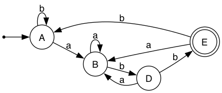

# Markdown Compiler

A tiny compiler that turns **Markdown** into *HTML*.
It handles ***bold italic*** text, `inline code` and \*escaped\* stars.

## Features

- Headings with automatic ids, like [this one](#features)
- **Strong**, *emphasis* and `code` spans
- Links such as [the CommonMark spec](https://spec.commonmark.org/?v=0.31&lang=en)
- Images: 

## Getting Started

1. Build it with `g++ -std=c++17 -o mdc src/*.cpp`
2. Run `./mdc demo/readme_sample.md`

### Example Code

```cpp
// Characters like < > & " are escaped in the output.
if (a < b && c > 0) std::cout << "hello";
```

### Unfinished Markup

An unclosed **star or a stray [bracket is shown as plain text, never an error.
Special characters such as <tag>, 100% and $5 & co are escaped.

Back to the [top](#markdown-compiler).
